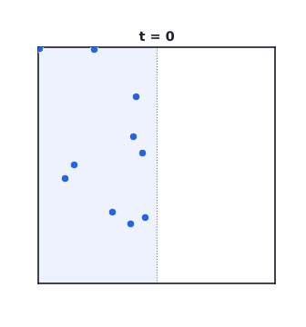
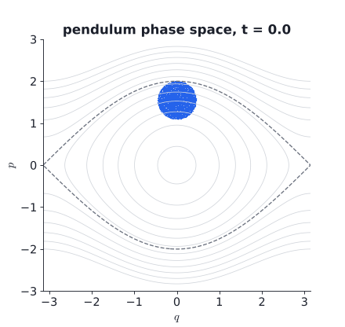

# Everything Comes Back (Eventually)

**The Poincaré Recurrence Theorem**, a classical mechanics course project at IIT Bombay.

Wait long enough and almost every state of a closed, frictionless system returns as close as we like to where it started. This repo has the simulations, the figures, the slides and the study notes.

<p align="center">
  
  
  
</p>

## Run the code

**In the browser (no install):** open `notebook/poincare_recurrence.ipynb` in Google Colab and press *Run all*.

**On a laptop:**

```bash
pip install -r requirements.txt
python src/make_all.py          # rebuilds every figure, about 2 to 3 minutes
python src/05_gas_in_box.py     # or just one script
```

| Script | What it shows | Key check |
|---|---|---|
| `01_proof_pigeonhole.py` | Copies of a disk under an area-keeping map must overlap | copy 17 hits the original |
| `02_liouville_blob.py` | Pendulum blob keeps its area. With friction it shrinks | area 0.63617 to 0.63616, damped matches $e^{-\gamma t}$ |
| `03_torus_oscillators.py` | Two oscillators, ratio $\varphi$, return near the start | mean return time matches $(2\pi)^n/(\lvert\omega\rvert\sigma_\varepsilon)$ within 3% |
| `04_cat_map.py` | Chaotic pixel shuffle returns exactly | period 25 on a $101 \times 101$ grid |
| `05_gas_in_box.py` | **Main numerical case.** $N$ particles, all start on the left | mean return time $= 2^N$ (Kac) for $N = 1$ to 14 |
| `06_gas_torus.py` | The gas drawn as a point on a torus: bounce = circle, 2 particles = square with glued edges, target = a quarter | mean wait 4.000 looks for $N = 2$ (Kac: 4) |


